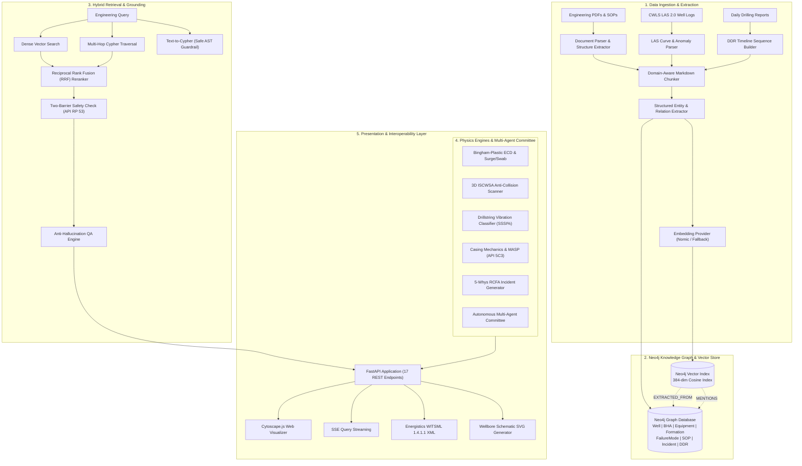

# Wellbore Knowledge Graph (GraphRAG)

[](https://www.python.org/)
[](https://fastapi.tiangolo.com)
[](https://neo4j.com)
[](https://www.docker.com)
[](https://pytest.org)
[](LICENSE)

An industrial-grade **Graph Retrieval-Augmented Generation (GraphRAG)** and subsurface drilling engineering intelligence platform. Designed for petroleum drilling engineers, well integrity auditors, and geoscientists to extract actionable operational intelligence from drilling manuals, IADC standards, Daily Drilling Reports (DDR), equipment integrity certifications, and historical incident logs without hallucinations.

---

## 1. System Architecture

### ASCII System Architecture

```
====================================================================================================
                             WELLBORE ENGINEERING GRAPHRAG PLATFORM
====================================================================================================

   [ RAW DATA ASSETS ]
   ├── Technical PDFs / Manuals (IADC, API RP 53, NORSOK D-010)
   ├── CWLS LAS 2.0 Well Logs (GR, RES, CALI, ROP, WOB)
   ├── Chronological Daily Drilling Reports (DDR Timeline Chains)
   └── Real-Time Rig Surface Telemetry (SPP, Torque, Pit Gain, Hookload)
            │
            ▼
   [ INGESTION SUBSYSTEM ]
   ├── Hierarchical Document & Section Boundary Chunker
   ├── Domain Entity & Relation Extractor (Serial Nos, Lithology, SOPs)
   └── Embedding Provider (Nomic-Embed-Text / Deterministic Hash Fallback)
            │
            ▼
   [ KNOWLEDGE GRAPH & VECTOR STORE (Neo4j 5.20) ]
   ├── High-Dimensional Vector Index (384-dim Cosine Similarity)
   ├── Relational Domain Ontology (Wells, BHA, Formations, Equipment, SOPs)
   ├── Sequential DDR Timeline Chains (:DDR)-[:NEXT_REPORT]->(:DDR)
   └── Global Community Risk Clusters (Hierarchical Graph Partitioning)
            │
            ▼
   [ HYBRID RETRIEVAL & GROUNDING ENGINE ]
   ├── Dense Vector Semantic Search (Top-K Chunks)
   ├── Multi-Hop Relational Cypher Traversal (1-3 Hops)
   ├── Reciprocal Rank Fusion (RRF) Reranker (w_v=0.6, w_g=0.4, k=60)
   ├── AST Read-Only Safe Cypher Guardrail (Rejects Data Mutations)
   └── Grounding QA Engine (Lexical & Semantic Anti-Hallucination Scorer)
            │
            ▼
   [ ENGINEERING SIMULATORS & SAFETY GUARDRAILS ]
   ├── Two-Barrier Rule Validator (API RP 53 / NORSOK D-010 Barrier Verification)
   ├── Bingham-Plastic Hydraulics & ECD Simulator (Surge/Swab Pressure Margins)
   ├── 3D Anti-Collision Scanner (ISCWSA Minimum Curvature & Separation Factor)
   ├── Drillstring Vibration Classifier (SSSI% Stick-Slip, Bit Bounce, Whirl)
   ├── Casing Integrity & MASP Calculator (API Spec 5C3 Burst, Collapse, Tension)
   ├── Automated 5-Whys RCFA Incident Post-Mortem Generator
   ├── Real-Time Telemetry Watchdog (Pack-Off, Kick, & Drilling Break Precursors)
   └── Multi-Agent Collaborative Drilling Advisory Panel (Consensus Directives)
            │
            ▼
   [ PRESENTATION & DELIVERY LAYER (FastAPI) ]
   ├── 17 REST API Microservice Endpoints
   ├── Server-Sent Events (SSE) Streaming Retrieval (/api/v1/query/stream)
   ├── Interactive Cytoscape.js Visual Knowledge Graph Dashboard (/api/v1/dashboard)
   ├── 2D Casing Architecture SVG Visualizer (/api/v1/wellbore/{name}/schematic.svg)
   └── Energistics WITSML 1.4.1.1 Standard XML Exporter (/api/v1/export/witsml/{name})
====================================================================================================
```

### Mermaid Architecture Workflow



---

## 2. Repository Layout

```
wellbore-knowledge-graph/
├── configs/                         # Production application & physics configurations
│   ├── app_config.yaml              # Domain thresholds, rheology models, & safety factors
│   ├── logging.yaml                 # Structured logging with file & console handlers
│   └── neo4j.conf                   # Reference Neo4j 5.20 APOC & memory configuration
├── data/                            # Raw sample technical documents & well logs
│   └── sample_docs/                 # Sample IADC guidelines, SOPs, and LAS files
├── docker/                          # Container orchestration definitions
│   ├── Dockerfile                   # Multi-stage security-hardened containerfile
│   ├── docker-compose.yml           # Production multi-container composition
│   ├── docker-compose.dev.yml       # Development stack with hot reload
│   ├── entrypoint.sh                # Executable readiness-probe initialization script
│   └── README.md                    # Docker deployment & orchestration guide
├── docs/                            # Comprehensive technical documentation
│   ├── architecture.md              # Deep-dive subsystem architecture & equations
│   ├── api_reference.md             # Complete REST endpoint specifications & payloads
│   ├── deployment.md                # Production bare-metal, Docker, & Kubernetes guide
│   ├── domain_glossary.md           # Oil & gas drilling terminology & API standards
│   └── quickstart.md                # 5-minute onboarding & developer tutorial
├── scripts/                         # Automation & database seeding scripts
│   ├── generate_sample_pdf.py       # Generates synthetic subsurface technical manuals
│   ├── seed_database.py             # Parses, chunks, embeds, & seeds Neo4j database
│   └── test_query.py                # Standalone retrieval benchmark script
├── src/                             # Core application source code
│   ├── api/                         # FastAPI application & REST endpoint routers
│   │   ├── main.py                  # Lifespan events, CORS, & app factory
│   │   └── routes.py                # 17 REST endpoints + SSE stream + Cytoscape dashboard
│   ├── embeddings/                  # Vector embedding providers (Ollama / Deterministic)
│   ├── graph/                       # Neo4j client, schema constraints, & Cypher queries
│   ├── ingestion/                   # Document parsing, chunking, LAS, & DDR timeline
│   ├── models/                      # Pydantic domain entities & API request/response models
│   ├── retrieval/                   # Hybrid RRF, Text-to-Cypher, physics simulators, & agents
│   └── config.py                    # Environment settings loaded via Pydantic
├── tests/                           # Comprehensive Pytest verification suite (45 tests)
├── .env.example                     # Environment template with documented parameters
├── .gitignore                       # Strict repository gitignore
├── Dockerfile                       # Root container build specification
├── docker-compose.yml               # Root multi-container orchestration stack
├── pyproject.toml                   # Hatchling project metadata & build configuration
└── requirements.txt                 # Pinned project dependencies
```

---

## 3. Quickstart

### Prerequisites
- Python 3.10+
- Git
- Docker & Docker Compose *(optional for full microservice orchestration)*

### Option A: Complete Docker Compose Stack

Run the complete multi-container stack (Neo4j with APOC, Ollama LLM provider, and FastAPI GraphRAG) with one command:

```bash
docker compose up -d --build
```

1. **Neo4j Browser UI**: [http://localhost:7474](http://localhost:7474) *(User: `neo4j`, Password: `wellborepassword123`)*
2. **FastAPI Web Service**: [http://localhost:8000](http://localhost:8000)
3. **Interactive Visual Dashboard**: [http://localhost:8000/api/v1/dashboard](http://localhost:8000/api/v1/dashboard)
4. **OpenAPI Swagger UI**: [http://localhost:8000/docs](http://localhost:8000/docs)

To pull the instruction and embedding models inside Ollama:
```bash
docker exec -it wellbore-ollama ollama pull llama3.2:latest
docker exec -it wellbore-ollama ollama pull nomic-embed-text
```

Seed the database:
```bash
docker exec -it wellbore-graphrag-api python scripts/seed_database.py
```

---

### Option B: Local Python Development (Resilient Offline Mode)

The application has zero hard external dependencies when running in local development mode—it features built-in in-memory graph buffering and deterministic normalized token embeddings:

```bash
# 1. Clone repository
git clone https://github.com/kirk-keel/wellbore-knowledge-graph.git
cd wellbore-knowledge-graph

# 2. Create virtual environment
python3 -m venv .venv
source .venv/bin/activate

# 3. Install dependencies
pip install -r requirements.txt

# 4. Configure environment
cp .env.example .env

# 5. Generate sample data & seed in-memory graph
python scripts/generate_sample_pdf.py
python scripts/seed_database.py

# 6. Start the API server
uvicorn src.api.main:app --host 0.0.0.0 --port 8000 --reload
```

---

## 4. REST API Endpoint Catalog

| Method | Endpoint | Description |
| :--- | :--- | :--- |
| `GET` | `/api/v1/health` | Service healthcheck & connected component status |
| `GET` | `/api/v1/graph/stats` | Neo4j graph entity & relationship counts |
| `GET` | `/api/v1/dashboard` | Cytoscape.js interactive graph dashboard (HTML) |
| `GET` | `/api/v1/graph/visual` | Graph nodes & edges formatted for Cytoscape.js |
| `POST` | `/api/v1/ingest/text` | Ingest raw text or markdown with automated extraction |
| `POST` | `/api/v1/ingest/file` | Ingest PDF, LAS 2.0, or TXT document |
| `POST` | `/api/v1/query/vector` | Pure semantic vector cosine similarity search |
| `POST` | `/api/v1/query/hybrid` | Hybrid Vector + Multi-Hop Graph Traversal + RRF Reranking |
| `GET` | `/api/v1/query/stream` | Server-Sent Events (SSE) streaming tokenized QA |
| `POST` | `/api/v1/query/cypher` | Text-to-Cypher agent with AST safety verification |
| `GET` | `/api/v1/graph/communities` | Global GraphRAG entity risk communities & summaries |
| `POST` | `/api/v1/safety/two-barrier`| Two-Barrier Rule safety guardrail (API RP 53 / NORSOK) |
| `POST` | `/api/v1/engineering/casing-check` | API Spec 5C3 burst, collapse, tension, & MASP check |
| `POST` | `/api/v1/engineering/hydraulics-ecd` | Bingham-Plastic ECD, pressure drops, surge/swab |
| `POST` | `/api/v1/engineering/anti-collision` | Minimum Curvature 3D scan & ISCWSA Separation Factor |
| `POST` | `/api/v1/engineering/vibration-classify` | Drillstring stick-slip (SSSI%), bit bounce, & whirl |
| `POST` | `/api/v1/reports/rcfa` | Automated 5-Whys Root Cause Failure Analysis report |
| `POST` | `/api/v1/telemetry/stream` | Real-time watchdog evaluating kick/pack-off precursors |
| `GET` | `/api/v1/wellbore/{well_name}/schematic.svg` | 2D wellbore architecture SVG rendering |
| `POST` | `/api/v1/query/multi-agent` | Autonomous multi-agent drilling engineering review |
| `GET` | `/api/v1/export/witsml/{well_name}` | Energistics WITSML 1.4.1.1 XML trajectory exporter |

---

## 5. Domain Physics & Well Integrity Highlights

### Two-Barrier Rule Guardrail (API RP 53 / NORSOK D-010)
Validates that every operational recommendation preserves at least two independent, verified well barriers (e.g. drilling fluid hydrostatic column + casing cement sheath or tested BOP pipe/blind shear rams). Operations with fewer than two active barriers are flagged with critical safety alerts.

### Bingham-Plastic Hydraulics & ECD Simulator
Computes annular velocities, laminar/turbulent flow regimes, frictional pressure drop, Equivalent Circulating Density (ECD), and tripping surge/swab margins:
$$ECD = \rho_{\text{mud}} + \frac{\Delta P_{\text{annular}}}{0.052 \times TVD}$$

### 3D Offset-Well Anti-Collision Scanner (ISCWSA)
Uses the Minimum Curvature method to calculate 3D spatial coordinates $(N, E, TVD)$ and evaluates the ISCWSA Separation Factor ($SF$):
$$SF = \frac{\text{Center-to-Center Distance}}{S_1 + S_2}$$
Triggers automatic collision avoidance warnings when $SF < 1.5$ and critical alarms when $SF < 1.0$.

### Drillstring Vibration Dysfunction Classifier
Calculates the Surface Stick-Slip Index (SSSI %):
$$SSSI\% = \frac{\Omega_{\max} - \Omega_{\min}}{2 \times \Omega_{\text{avg}}} \times 100\%$$
Identifies torsional stick-slip, axial bit bounce, and backward whirl to prevent downhole MWD tool failure and drillstring twist-offs.

---

## 6. Verification & Test Suite

The repository contains an exhaustive test suite verifying ingestion, retrieval fusion, AST Cypher safety, physics simulators, and API endpoints:

```bash
pytest -v
```

```
============================== 45 passed in 1.44s ==============================
```

---

## 7. Extended Documentation

For in-depth guides, see the [`docs/`](docs/) directory:
- [System Architecture](docs/architecture.md)
- [REST API Reference](docs/api_reference.md)
- [Production Deployment Guide](docs/deployment.md)
- [Domain Glossary & Engineering Standards](docs/domain_glossary.md)
- [Developer Quickstart](docs/quickstart.md)
- [Docker Deployment Guide](docker/README.md)

---

## 8. License

This project is licensed under the MIT License. See [LICENSE](LICENSE) for details.
