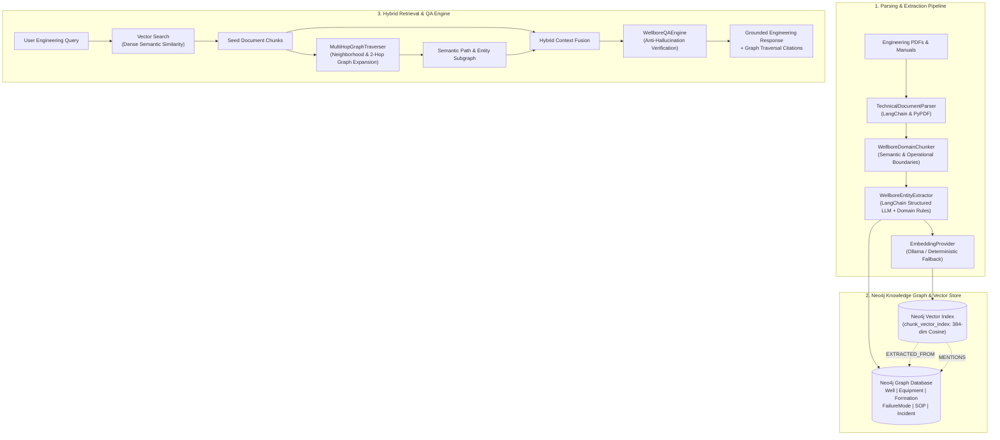
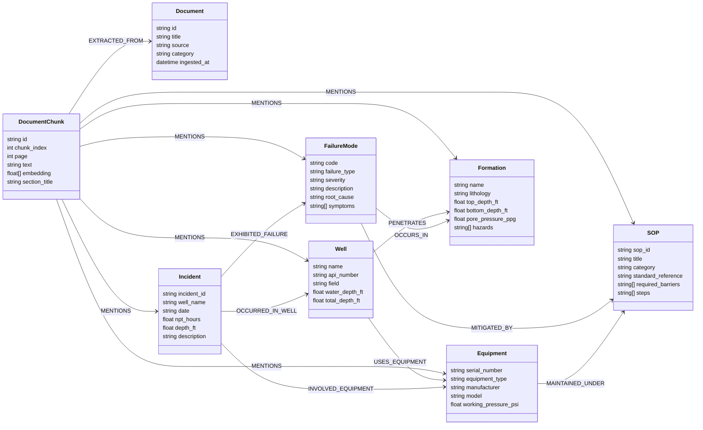

# Wellbore Knowledge Graph (GraphRAG)

An advanced Graph Retrieval-Augmented Generation (GraphRAG) system engineered for subsurface drilling engineering, IADC standards, well programs, equipment integrity manuals, and historical incident post-mortems.

By synthesizing **dense vector search** over technical documents with **multi-hop semantic graph traversals** across physical assets, failure modes, lithological horizons, and standard operating procedures (SOPs), this platform delivers grounded engineering answers without hallucinations.

---

## 1. System Architecture



---

## 2. Graph Database Schema & Ontology

The graph combines unstructured textual evidence with formal domain ontology:



---

## 3. Core Capabilities

### A. Domain-Aware Parsing & Extraction
- **PDF & Text Ingestion**: Preserves page numbers, table boundaries, and document structure.
- **Entity Extraction**:
  - **Equipment Serial Numbers**: `BOP-HYD-5000-08`, `MM-775-A1`, `MWD-TENSOR-882`, `CSG-958-L80`.
  - **Formation Lithologies**: Depth-tagged horizons (e.g. `Eagle Ford Shale`, `Brent Sandstone`, `Norphlet Formation`) with pore pressure and hazard flags.
  - **Failure Mechanisms**: `FAIL-PACKOFF`, `FAIL-RAMLEAK`, `FAIL-TWISTOFF`, `FAIL-KICK`, `FAIL-LOSTCIRC`.
  - **SOPs & Standards**: `IADC-WCC-04`, `API-RP-53`, `SOP-SP-774`, `SOP-SHUTIN-01`.

### B. Neo4j 5+ Vector & Multi-Hop Traversal
- **Vector Index**: Neo4j-native vector index (`chunk_vector_index`) using cosine similarity.
- **Graph Traversal**: Traverses from seed text chunks to mentioned assets, then expands 1 to 2 hops across failure modes, past incident non-productive time (NPT), and mitigating procedures.

### C. Anti-Hallucination QA Engine
- **Constraint-Grounded Reasoning**: Answers are generated strictly from verified graph paths and retrieved text excerpts.
- **Traceable Attribution**: Output includes exact entity identifiers, parent standard codes, and the explicit Cypher traversal trail.
- **Defensive Fallback**: If evidence is missing, the system explicitly reports lack of data rather than hallucinating plausible engineering values.

---

## 4. Quickstart & Deployment

### Option A: Local Docker Compose (Neo4j + Ollama + API)

Run the full stack with one command:

```bash
docker compose up -d
```

This starts:
1. **Neo4j 5.20** on `bolt://localhost:7687` (Browser UI: `http://localhost:7474`, User: `neo4j`, Password: `wellborepassword123`)
2. **Ollama** on `http://localhost:11434`
3. **FastAPI Query Service** on `http://localhost:8000` (Docs: `http://localhost:8000/docs`)

To pull Ollama models inside the container:
```bash
docker exec -it wellbore-ollama ollama pull llama3.2:latest
docker exec -it wellbore-ollama ollama pull nomic-embed-text
```

### Option B: Local Python Environment

1. **Clone repository & setup virtual environment**:
   ```bash
   git clone https://github.com/organization/wellbore-knowledge-graph.git
   cd wellbore-knowledge-graph
   python3 -m venv .venv
   source .venv/bin/activate
   pip install -r requirements.txt
   pip install -e .
   ```

2. **Configure environment**:
   ```bash
   cp .env.example .env
   ```

3. **Seed sample domain documents**:
   ```bash
   python3 scripts/seed_database.py
   ```

4. **Start FastAPI service**:
   ```bash
   uvicorn src.api.main:app --host 0.0.0.0 --port 8000 --reload
   ```

---

## 5. API Reference

Interactive OpenAPI documentation is available at `http://localhost:8000/docs`.

### 1. Hybrid GraphRAG Query
`POST /api/v1/query/hybrid`

**Request:**
```json
{
  "question": "What SOPs mitigate drillstring pack-off and BOP ram leak failures?",
  "top_k_chunks": 5,
  "graph_hops": 2,
  "min_similarity": 0.30,
  "include_graph_paths": true
}
```

**Response:**
```json
{
  "question": "What SOPs mitigate drillstring pack-off and BOP ram leak failures?",
  "answer": "### Operational Analysis & Findings\n- Failure Mode [FAIL-PACKOFF]: Mitigated according to standard procedure(s) SOP-SP-774, IADC-WCC-04.\n- Failure Mode [FAIL-RAMLEAK]: Mitigated according to standard procedure(s) API-RP-53, SOP-SHUTIN-01.\n...",
  "confidence_score": 0.94,
  "retrieved_chunks": [
    {
      "chunk_id": "IADC_Well_Control_Guidelines_Kick_Detection:c0_4c59a3c2",
      "doc_id": "IADC_Well_Control_Guidelines_Kick_Detection",
      "page": 1,
      "text": "Upon detection of any pit gain exceeding 5 bbl...",
      "similarity_score": 0.892
    }
  ],
  "graph_paths": [
    {
      "source_label": "FailureMode",
      "source_id": "FAIL-PACKOFF",
      "source_name": "Pack-off",
      "relation": "MITIGATED_BY",
      "target_label": "SOP",
      "target_id": "SOP-SP-774",
      "target_name": "SOP-SP-774"
    }
  ],
  "entities_cited": [
    {
      "entity_type": "FailureMode",
      "entity_id": "FAIL-PACKOFF",
      "entity_name": "Pack-off",
      "relation_to_context": "Connected via MITIGATED_BY to SOP-SP-774"
    }
  ],
  "reasoning_summary": "Grounding verification complete. Consulted 3 document chunks, traversed 6 graph relationships, and cited 4 verified domain entities.",
  "sources_consulted": ["IADC_Well_Control_Guidelines_Kick_Detection", "SOP_SP_774_Drillstring_Packoff_Remediation"]
}
```

### 2. Document Ingestion
`POST /api/v1/ingest/file` (Multipart form upload: `file`, `category`, `doc_id`)

Supports technical engineering PDFs, daily drilling reports (DDR), well programs, and IADC standards.

### 3. Graph Traversal Inspection
`POST /api/v1/query/graph`

**Request:**
```json
{
  "entity_type": "Equipment",
  "entity_id": "BOP-HYD-5000-08",
  "max_hops": 2
}
```

### 4. Graph Statistics
`GET /api/v1/graph/stats`

---

## 6. Running Tests

Execute the comprehensive test suite with pytest:

```bash
pytest -v
```
