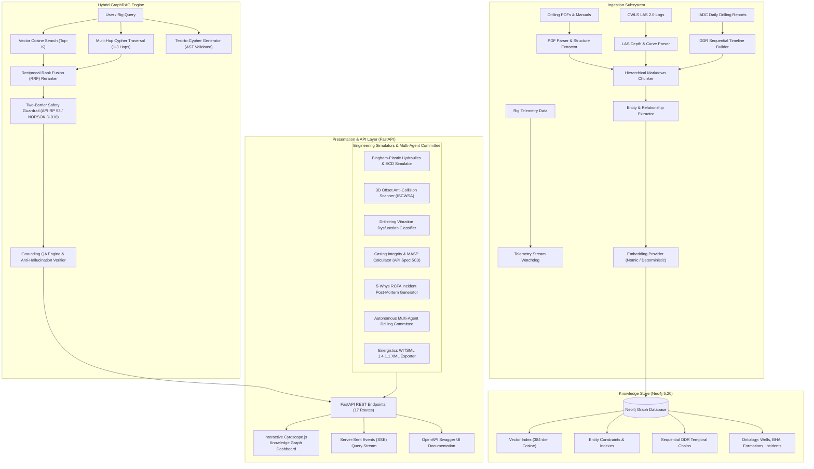

# System Architecture

The **Wellbore Engineering Knowledge Graph (GraphRAG)** integrates structural graph topologies with high-dimensional vector embeddings, generative LLM reasoning, deterministic engineering physics simulators, and safety guardrails.

## High-Level Architecture Diagram

---

## Subsystem Details

### 1. Ingestion Pipeline
- **Hierarchical Document Parsing**: Extracts section headers, tables, bullet points, equipment serial numbers, lithology descriptions, and SOP instructions.
- **CWLS LAS 2.0 Parsing**: Reads well log headers (~WELL, ~CURVE, ~PARAMETER, ~ASCII) and detects log anomalies (e.g., severe washouts where $CALI > 14''$, or hydrocarbon gas shows with $RES > 50\,\Omega\cdot\text{m}$ and $GR < 40\,\text{API}$).
- **DDR Timeline Chaining**: Connects daily drilling reports chronologically via `(:DDR)-[:NEXT_REPORT]->(:DDR)` to allow sequential querying of NPT, mud weight changes, and drilling problems over time.

### 2. Neo4j Knowledge Graph Schema
- **Nodes**: `Well`, `Wellbore`, `BHA`, `BHAComponent`, `Formation`, `Equipment`, `Incident`, `SOP`, `DailyDrillingReport`, `WellLogCurve`, `Chunk`.
- **Relationships**: `LOCATED_IN`, `HAS_BHA`, `CONTAINS_COMPONENT`, `PENETRATES`, `HAS_INCIDENT`, `INVOLVED_EQUIPMENT`, `MITIGATED_BY`, `HAS_SOP`, `RECORDED_DDR`, `NEXT_REPORT`, `HAS_LOG_CURVE`, `EXTRACTED_FROM`.
- **Vector Index**: 384-dimensional cosine index on `Chunk(embedding)`.

### 3. Hybrid Retrieval & RRF Ranking
Queries leverage two complementary retrieval pathways:
1. **Vector Cosine Similarity**: Scans indexed semantic document chunks for contextual nuance.
2. **Multi-Hop Cypher Traversal**: Traverses entity paths up to $N$ hops to gather connected domain relationships (e.g., equipment $\to$ failure mode $\to$ mitigation SOP).
3. **Reciprocal Rank Fusion (RRF)**: Merges both sets of results:
   $$RRF(d) = \sum_{m \in M} \frac{w_m}{k + r_m(d)}$$
   where $k=60$, vector weight $w_v = 0.6$, and graph weight $w_g = 0.4$.

### 4. Safety Guardrails & Anti-Hallucination
- **Two-Barrier Rule Enforcement**: Strict compliance checks against NORSOK D-010 and API RP 53. If a proposed operational intervention leaves fewer than 2 independent, verified well barriers in place (e.g., only one casing/fluid column or compromised BOP ram), execution is intercepted and critical warnings are flagged.
- **Grounding Verification**: The QA engine calculates the lexical and semantic overlap between the LLM generation and the retrieved context chunks, annotating any ungrounded assertions.
- **AST Cypher Validator**: Inspects generated Cypher queries against an abstract syntax tree allowlist to reject mutations (`DELETE`, `DROP`, `CREATE`, `SET`, `MERGE`, `CALL`) before execution.

### 5. Deterministic Engineering Physics Engines
- **Hydraulics & ECD Engine**: Bingham-Plastic flow model computing annular velocities, frictional pressure losses, Equivalent Circulating Density, and surge/swab margins.
- **3D Offset Anti-Collision Scanner**: Minimum Curvature algorithm for 3D trajectory interpolation ($N, E, TVD$), combined with ISCWSA ellipsoid error modeling and Separation Factor ($SF = \frac{CC}{S_1 + S_2}$) warnings.
- **Drillstring Vibration Dysfunction Classifier**: Surface Stick-Slip Index (SSSI %) classification, bit bounce axial vibration detection, and backward whirl centrifugal acceleration estimation.
- **Casing Mechanics & MASP Calculator**: API Spec 5C3 burst (Barlow), collapse (plastic/yield), and axial tension calculations with Maximum Allowable Surface Pressure (MASP) safety factors.
- **WITSML 1.4.1.1 XML Exporter**: Standardized Energistics-compliant well, wellbore, and trajectory export for integration with Halliburton Landmark, Schlumberger Petrel, and Baker Hughes JewelSuite.
